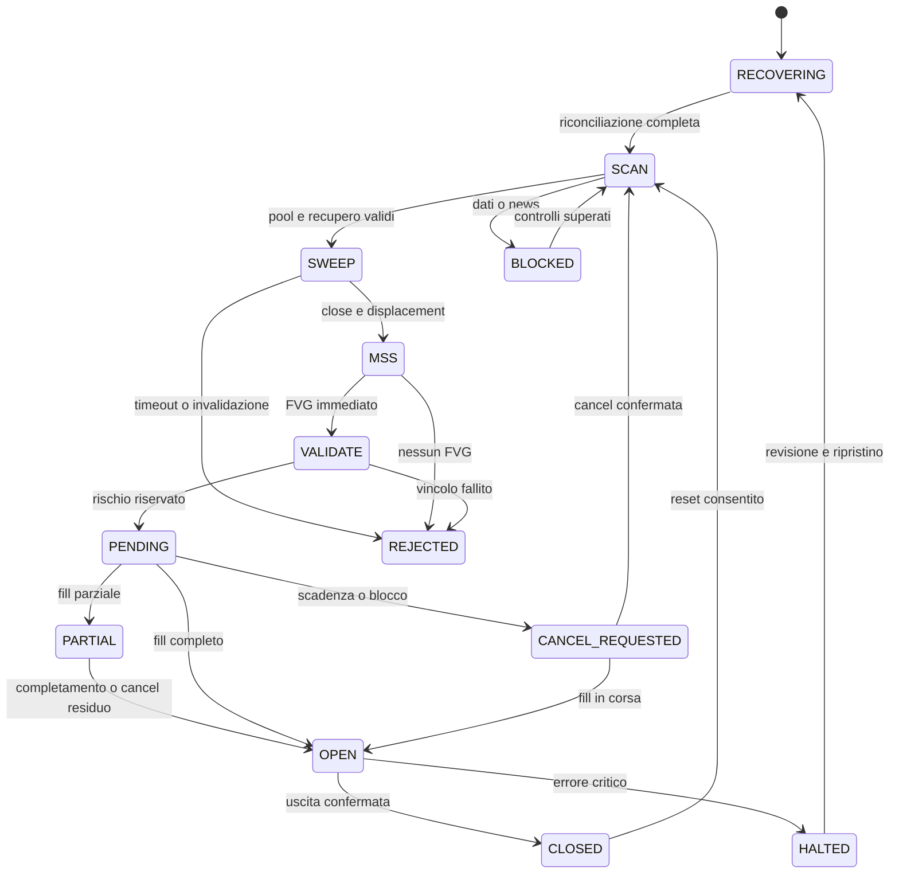

# Signal engine e macchina a stati
## Event order normativo
Per event_time uguale: applicare execution report/posizione broker, aggiornare rischio, applicare stop/cancel/blackout, chiudere barra, aggiornare feature disponibili, generare intent, riservare rischio atomicamente, inviare ordine simulato. Sequenza broker prevale sulle convenzioni locali se disponibile. Dati tardivi non riscrivono decisioni già prese: annotare correzione e marcare replay divergente. Store append-only con event_id e checksum; replay deterministico a parità di eventi ordinati/config/versione.



|Stato|Ingresso / dati|Azioni e evento atteso|Timeout e invalidazione|Log e recovery|
|---|---|---|---|---|
|RECOVERING|avvio, WAL, ordini/fill/balance broker|bloccare ingressi, query paginata; diff per client_id|30 s proposta; incongruenza→HALTED|snapshot hash, cursore; broker fonte per esposizione|
|SCAN|dati validi, warmup completo|calcolo pivot causalmente disponibili; attende sweep|nessuno; dati mancanti→BLOCKED|ogni barra WAIT/SKIP; riprodurre warmup|
|SWEEP|pool ID, estremo, break_level congelati|MSS su barre successive|6 barre; nuovo estremo→REJECTED|snapshot setup, restart ripristina solo con feed completo|
|MSS|indice impulso, ATR e close|FVG terza barra|1 barra; no gap→REJECTED|log soglie e valori; non prolungare dopo restart|
|VALIDATE|intent completo, metadata, rischio, calendario|validare geometria, costi, quantity, capability|decisione atomica; qualsiasi vincolo→REJECTED|reason codes e input hash; non inviare intent scaduto|
|PENDING|ordine ack, risk reservation|attende fill; monitora invalidazioni|6 barre / session end / blackout|order IDs; restart query, mai resend cieco|
|PARTIAL|cum_qty>0, leaves_qty>0|proteggere quantità eseguita; cancel residuo al TTL|protezione non confermata entro 2 s→HALTED/exit|execution_id dedup; rischio include filled+remaining|
|CANCEL_REQUESTED|cancel intent persistita|attende ack terminale o fill|2 s→query; non liberare riserva senza certezza|ordine può riempirsi durante cancel|
|OPEN|quantità broker e stop protettivo|OCO/stop/target/time/news; no nuova entry|24 barre o cutoff; mancata protezione→emergenza|MTM e fee; restart ricostruisce fills, non somma duplicati|
|CLOSED|posizione zero confermata|cancel fratelli residui, contabilizzare, liberare rischio|ordine residuo→HALTED|PnL lordo/netto, slippage, duration, adverse excursion|
|REJECTED/EXPIRED|violazione o scadenza|consumare setup, tornare SCAN barra successiva|nessun retry identico|motivo e counterfactual solo research|
|BLOCKED|news, feed, API manutenzione|cancel entry, conserva/gestisce protezioni|rientro solo 3 quote valide consecutive e calendario fresco|registra intervallo e causa; warmup dopo gap|
|HALTED|kill switch, drawdown o ordine orfano|stop nuove entry, cancel pendenti, emergency reduce-only dove possibile|nessun auto resume per drawdown/kill manuale|allarme persistente; umano sblocca solo dopo reconcile|

## Pseudocodice indipendente dallo stack
```text
on_event(event):
  deduplicate(event_id); append_wal(event)
  if execution_report: apply_monotonic_cumulative_fill(); update_position_and_reservations()
  if protection_trigger or scheduled_exit: execute_exit_priority(); return
  if event != CLOSED_BAR: update_health_and_quotes(); return
  validate_data_and_asof_dependencies()
  if gate_failed: invalidate_setup(); cancel_pending_if_any(); audit(reason); return
  if active_exposure: manage_only(); return
  atr = true_range_mean(previous_completed_bars)
  pivots = pivots_confirmed_strictly_before_this_bar
  if setup is empty: choose_unconsumed_sweep(); freeze_opposite_pivot(); return
  if sweep_extreme_broken or elapsed>ttl: reject(); return
  if awaiting_MSS: require_directional_close_and_displacement(); return
  if awaiting_FVG: require_MSS_as_middle_candle(); else reject()
  entry,stop,target = quantized_geometry()
  qty = largest_step_multiple_satisfying_all_limits()
  if qty == 0: reject(reason)
  else: atomic_reserve_risk(); persist_intent(); submit_idempotently()
```

## Decision matrix, prima condizione prevalente
|Priorità|Condizione|Azione/codice|
|---|---|---|
|0|stop/target effettivamente eseguito|CLOSE_POSITION / EXIT_STOP o EXIT_TARGET|
|1|kill globale, DD≥8%, ordine orfano|DISABLE_STRATEGY / DISABLE_KILL_SWITCH, DISABLE_DRAWDOWN, DISABLE_ORPHAN|
|2|feed perso, timestamp futuro, OHLC impossibile|CANCEL_PENDING_ORDER / CANCEL_DATA_INVALID; SKIP_DATA_INVALID per nuovo segnale|
|3|API 3 errori consecutivi o manutenzione|DISABLE_API_ERRORS / SKIP_VENUE_MAINTENANCE|
|4|calendario stale oppure blackout|CANCEL_NEWS_BLACKOUT / SKIP_CALENDAR_STALE / SKIP_NEWS_BLACKOUT; CLOSE_POSITION all'inizio finestra|
|5|fuori sessione / TTL superato|CANCEL_SESSION_END / CANCEL_EXPIRED; CLOSE_POSITION al cutoff|
|6|rischio daily/weekly/streak/trade/concentrazione|SKIP_DAILY_LOSS / SKIP_WEEKLY_LOSS / SKIP_LOSS_STREAK / SKIP_TRADE_LIMIT / SKIP_AGGREGATE_RISK|
|7|spread/ATR>0,10 o slippage/ATR>0,05|SKIP_SPREAD_TOO_HIGH / SKIP_SLIPPAGE|
|8|sweep mancante / MSS incompleto / FVG atteso|WAIT_SWEEP / WAIT_MSS / WAIT_FVG|
|9|sweep invalidato / MSS/FVG scaduto|SKIP_SWEEP_INVALIDATED / SKIP_MSS_EXPIRED / SKIP_FVG_EXPIRED|
|10|filtri opzionali contrari|SKIP_HTF_BIAS / SKIP_PREMIUM_DISCOUNT / SKIP_DAILY_BIAS|
|11|stop non valido / entry già attraversata / target consumato|SKIP_INVALID_GEOMETRY / SKIP_ENTRY_PASSED / CANCEL_TARGET_CONSUMED|
|12|target assente o net RR<1,5|SKIP_NO_TARGET / SKIP_NET_RR|
|13|min size/notional, cash, margin, short unsupported|SKIP_MINIMUM_SIZE / SKIP_CASH / SKIP_MARGIN / SKIP_SHORT_UNSUPPORTED|
|14|tutto valido e riserva atomica riuscita|ENTER_LONG / ENTER_SHORT|

API failure non significa che l'ordine non sia stato accettato. Timeout genera UNKNOWN, non REJECTED. Reconcile prima di retry. Il prezzo passato durante latenza non autorizza convertire limit in market. I codici del codice reference sono un sottoinsieme esplicito della matrice normativa.
